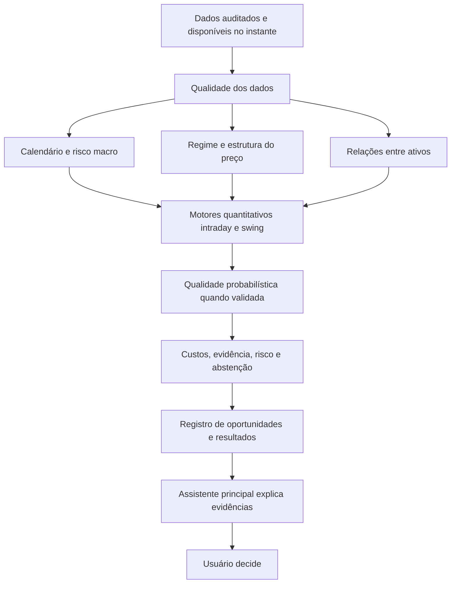

# Plano de continuidade — IA de recomendações do OneB

Data: 09/10/2026. Versão: 1.0. Responsável pela execução técnica: Codex, com acompanhamento do usuário. Estado: plano elaborado; as etapas abaixo ainda não foram executadas nesta solicitação.

## 1. Objetivo e resultado esperado

Construir um assistente que ajude a identificar oportunidades, riscos e motivos para aguardar, com recomendações rastreáveis e desempenho medido. O usuário decide se opera; o sistema não envia, altera nem encerra ordens.

O usuário escolheu **intraday e swing, avaliados separadamente**. O produto terá dois programas de pesquisa, dois placares de desempenho e critérios próprios por ativo, regra, horizonte e versão. A aprovação de um programa não aprova o outro.

O objetivo inicial de pesquisa é encontrar **ao menos uma política com vantagem econômica demonstrável**, mantendo os cinco ativos no acompanhamento: Nasdaq, S&P 500, ouro, EURUSD e WTI. Cada ativo pode receber contexto, alertas ou recomendações conforme sua evidência. Falta de dados ou de vantagem produz um estado explícito de espera; não justifica excluir o S&P 500 para facilitar o resultado.

Entregas pretendidas:

1. Base auditada e reproduzível dos cinco ativos.
2. Registro atualizado de tudo que já foi testado, inclusive resultados negativos.
3. Conclusão do laboratório existente, com o executor corrigido e auditado.
4. Uma linha intraday e uma linha swing com regras e avaliação independentes.
5. Assistente que explique dados e riscos desde o início e acrescente recomendações direcionais apenas onde os critérios forem satisfeitos.
6. Histórico prospectivo de todas as oportunidades, recusas e resultados.

**O plano define como obter e reconhecer resultados confiáveis; não pressupõe que exista uma estratégia lucrativa nesses dados.** Se nenhum candidato passar, o produto continuará útil para contexto e risco, e a campanha terminará com essa conclusão documentada.

## 2. Diagnóstico do ponto de partida

Há progresso concreto em infraestrutura e rigor. Já existem máquinas de estado de setups, simulação com custos, registro de oportunidades, ferramentas de IA somente leitura, verificador de evidências, avaliações de respostas e mecanismos de bloqueio. Esses componentes devem ser reaproveitados após revisão.

O gargalo atual é evidência de vantagem, acompanhado de problemas de dados e de validação. A pesquisa não está no zero, mas ainda não sustenta um recomendador direcional aprovado.

| Frente | Situação documentada | Consequência para o plano |
|---|---|---|
| Tendência 1/3/12 meses | `NOT_SIGNIFICANT`: −0,08% ao mês, IC95% −0,23% a +0,06%; 17 instrumentos; exclusões sob suspeita de bloqueio da fonte | Corrigir dados e reproduzir o protocolo original. Enquanto isso, contexto descritivo |
| Calendário macro | Evidência histórica de aumento de volatilidade em vários pares evento × ativo; direção não aprovada | Primeira utilidade do assistente: alertas contextualizados de risco. Completar ouro e WTI |
| Gold Fakeout aberto/original e 13X ouro H1 | Regras testadas arquivadas por resultados econômicos negativos | Preservar conclusões. Não priorizar novas otimizações dessas versões |
| London Box e 100 Pips no feed externo | Transferência de sinais entre feeds reprovada; resultados descritivos | Não apresentar como recomendadores nem universalizar a rejeição para outros instrumentos |
| Breakout Nasdaq / fade ouro | Pistas exploratórias positivas que não passaram a correção estatística | Hipóteses para replicação, sem selo de vantagem |
| ML sobre setups / modelo diário legado | Não há ganho incremental robusto demonstrado nos relatórios revisados | Complexidade adicional fica condicionada à comparação com regras simples |
| `lab_v1` | Pré-registro de 70 candidatos em cinco ativos; não encontrei resultados em `D:\OneB\research\lab_v1` nem `output\lab_v1` | Auditar o executor e concluir a campanha antes de abrir buscas grandes |
| Operação de recuperação | Há script de espera pelo canário; estado das tarefas em execução não foi confirmado | Inventariar processos e logs na primeira etapa; arquivo de script não prova execução |

O [índice de evidências](indice_evidencias_2026-10-09.md) relaciona relatórios, decisões e limitações. O [plano de 05/10](../plans/oneb_ai_recommendation_plan.md) permanece como histórico de arquitetura e implementação; este documento atualiza prioridades e validação.

## 3. O que significa assertividade neste projeto

Uma recomendação precisa declarar **o evento previsto, o horizonte e a forma de medir o resultado**. Há três perguntas diferentes:

| Pergunta | Medida apropriada | Uso |
|---|---|---|
| O preço tende a subir ou cair até determinada data? | Acurácia direcional, matriz de erros e comparação com a frequência base | Cenário de preço; não equivale a operação rentável |
| Este plano termina com resultado líquido positivo? | Probabilidade calibrada de `R_liquido > 0`, incluindo saídas por prazo | Qualidade econômica do plano |
| O alvo é atingido antes do stop, dentro do prazo? | Probabilidade desse evento específico, com stop, alvo e prazo congelados | Apenas quando este for o rótulo realmente treinado |

Não intercambiar essas probabilidades. O `Signal Quality` atual usa resultado líquido positivo; isso não é automaticamente probabilidade de atingir o alvo. Para shorts, não usar `1 − P(alta acima de um limiar)` como probabilidade de queda: há resultados laterais e intermediários.

O placar de cada programa mostrará:

- Expectância líquida em R e intervalo de confiança, depois de spread, comissão, slippage e financiamento aplicável.
- Resultado por sessão/período e diferença contra uma referência simples, sob orçamento de risco comparável.
- Taxa de operações líquidas positivas e intervalo; taxa de alvo antes do stop em coluna separada quando pertinente.
- Drawdown, concentração dos ganhos, estabilidade temporal e risco simultâneo.
- Qualidade probabilística: Brier/log-loss contra previsão base, curva de calibração, quantidade de casos por faixa e incerteza.
- Cobertura: oportunidades consideradas, aceitas, recusadas, expiradas, censuradas e motivo das recusas.
- Qualidade de dados e parcela de custos reconstruídos.

**Critério central proposto para novas campanhas:** expectância líquida positiva com limite inferior do intervalo acima de zero, vantagem sobre o comparador pré-definido e confirmação em dados prospectivos. Taxa de acerto isolada não é critério de promoção.

Exemplo didático, sem custos: ganhar 1R em 60% e perder 2R em 40% resulta em −0,20R por operação. Ganhar 2R em 45% e perder 1R em 55% resulta em +0,35R. O retorno de cada resultado importa junto com o acerto.

## 4. Escopo dos dois programas

| Item | Intraday | Swing |
|---|---|---|
| Pergunta principal | Há uma oportunidade executável e economicamente favorável nesta sessão? | Há um cenário economicamente favorável para os próximos cinco pregões? |
| Horizonte inicial proposto | Até o encerramento da sessão; limite máximo de seis horas para novas regras desse programa | Cinco pregões como alvo primário; um pregão como descrição secundária |
| Dados | M5 bid/ask, agregações causais M15/H1, calendário, quote e sessão | Barras diárias e contexto H1, custos de permanência, calendário e séries externas disponíveis na decisão |
| Instrumentos | Os cinco principais; elegibilidade individual por qualidade/feed | Os mesmos cinco; elegibilidade individual por histórico e custo |
| Horário da informação | Após fechamento da barra, com disponibilidade registrada | Após fechamento confirmado do instrumento; próxima janela executável |
| Execução simulada | Primeira quote/barra executável posterior, com latência e custo | Próxima sessão/janela executável, com spread, gaps e financiamento |
| Primeira comparação | Regra simples congelada versus a mesma regra filtrada | Regra simples congelada versus modelo/contexto adicional |

Os valores de horizonte acima são escolhas de desenho propostas, a congelar antes de novos resultados. Não alteram o `lab_v1`: ele tem regras com permanência de até 72/120 horas. Um setup calculado em H1 pode ser multidiário; classificar pelo prazo efetivo e avaliar sua política original. Não encerrar operações do laboratório mais cedo para adaptá-las ao nome “intraday”.

S&P 500 e Nasdaq são mercados relacionados. Essa relação pode informar risco e contexto, mas não fornece duas confirmações independentes de um mesmo sinal.

## 5. Arquitetura: especialistas com responsabilidades verificáveis

Não precisamos começar com várias LLMs votando. A primeira versão usará módulos especializados e um assistente principal. Modelos adicionais só entram quando sua contribuição puder ser medida.

| Especialista | Responsabilidade | Validação |
|---|---|---|
| Auditor de dados | Frescor, canário, lacunas, fonte, símbolos e reconstruções | Fixtures de falha, comparação de fontes e manifesto |
| Calendário/risco macro | Eventos próximos e distribuição histórica de movimentos | Protocolo `calendar_v1`; não inferir direção da volatilidade |
| Regime/estrutura | Tendência, lateralidade, volatilidade e estado do setup | Features causais; ablação para medir contribuição à política |
| Relações entre ativos | Contexto de índices, câmbio, juros e ouro | Comparação fora da amostra com e sem esse contexto |
| Motor de oportunidades | Regra, lado, níveis, validade e resultado simulado | Replay causal, execução realista, baselines e confirmação |
| Qualidade do sinal | Probabilidade de evento explicitamente definido e filtro de seleção | Validação temporal, calibração e ganho econômico incremental |
| Risco/evidência | Bloquear custo excessivo, dado inválido, falta de vantagem ou risco agregado | Regras determinísticas e testes de cenários |
| Assistente principal | Explicar cenário, evidências, contrapontos e o que mudou | Verificador de números/fontes, avaliações e fallback |

Módulos já existentes: `app/setups/`, `app/execution_sim.py`, `app/opportunity.py`, `app/opportunity_ledger.py`, `app/forward_stats.py`, `app/signal_quality.py`, `app/calendar_risk.py`, `app/oneb_ai/`, `app/lab/` e interfaces em `frontend/src/components/assistant/`.

Apenas Gold Fakeout está atualmente registrado no catálogo de setups do executor shadow. Um sobrevivente do laboratório precisa ser adaptado à máquina de estados e passar pela comparação evento a evento entre replay e execução online antes da coleta de sua política.

O texto da IA não promove um setup e não cria probabilidades, preços ou estatísticas. O motor fornece o objeto estruturado; a IA explica. Discordâncias entre módulos devem aparecer no cartão.

## 6. Protocolo científico e critérios de passagem

### 6.1 Dados e reconstrução

Antes de novo cálculo confirmatório:

1. Distinguir `SOURCE_BLOCKED`, `FETCH_ERROR`, `CONFIRMED_GAP` e `COMPLETE`; registrar evidências, tentativas e horários.
2. Revalidar lacunas anteriores com canário saudável e retentativas moderadas. Um canário de outro ativo/timeframe reduz a suspeita de bloqueio geral, mas não prova completude do ativo alvo.
3. Preservar arquivos antigos, identificar a nova versão e vincular hashes a cada relatório.
4. Validar timezone/DST, sessões, bordas e lacunas internas, duplicatas, OHLC, volumes, alinhamento bid/ask e spreads finitos não negativos.
5. Registrar cada reconstrução: ativo, período, lado observado, lado estimado, janela do spread, método e proporção afetada.
6. Se ambos os lados faltarem, o trecho continua inválido; não criar trajetória de preço.

**S&P 500:** o downloader atual calcula midpoint depois de reconstruir um lado. Portanto, a frase “só altera custos” ainda não é uma propriedade garantida do código. A etapa P0 deve medir efeito em retornos, sinais e fronteiras dos trechos reconstruídos.

Para novos protocolos, congelar uma referência observada de preço consistente ao longo da série e separar a estimativa de custo; não alternar lado ou deslocar a trajetória retrospectivamente sem medir o efeito. Se não houver referência observada consistente, registrar limitação e bloquear inferência que dependa dela. O ativo continua no acompanhamento.

O teste `tsmom_v1` já define midpoint. Sua reprodução corretiva deve preservar essa definição, declarar imputações e mostrar sensibilidade. Uma mudança de definição de preço exige versão metodológica própria; não substituir silenciosamente o teste original.

A mediana usada como feature ou custo de decisão deve vir de dados anteriores à decisão/treino. Uma estimativa retrospectiva com dados posteriores pode ser cenário de sensibilidade, devidamente identificado. Spread estimado não certifica execução no broker.

### 6.2 Tempo, teste final e tentativas

- Separar desenvolvimento, seleção/calibração e teste final por data, preservando todos os ativos simultâneos no mesmo bloco.
- Remover treino cujo `label_end_at` atravesse a fronteira; aplicar embargo coerente com a política e sobreposição real.
- Ajustar imputação, normalização, seleção de features, hiperparâmetros, calibrador e limiar de abstenção somente nos blocos permitidos.
- Dados já examinados não voltam a ser teste intocado depois de um redownload. A correção de fonte permite replicação corrigida; não apaga conhecimento dos resultados.
- Registrar toda variante tentada. Primeiro concluir os 70 candidatos do laboratório existente; não adicionar parâmetros para fabricar sobreviventes.
- Preservar a decisão histórica do `lab_v1`. Mudança material no executor/protocolo requer nota de correção, versionamento e lock antes dos resultados, com avaliação independente posterior.
- Para novas campanhas, limitar a busca a **até quatro políticas candidatas por programa**. Isso não significa quatro testes: a família confirmatória deve enumerar políticas × ativos × lados × horizontes e filtros quando gerarem conclusões separadas. Não reduzir o número depois dos resultados. Um resultado agregado não aprova automaticamente cada ativo.
- Proposta para novas confirmações: controle de erro familiar de 5% com Holm e intervalos simultâneos compatíveis para as conclusões primárias. Isso não reescreve o BH q≤0,10 já registrado no `lab_v1`.

Treino e teste em ordem temporal são o ponto de partida; sobreposição de rótulos exige controles adicionais. Referência: [TimeSeriesSplit, documentação oficial](https://scikit-learn.org/stable/modules/generated/sklearn.model_selection.TimeSeriesSplit.html).

### 6.3 Comparação econômica e dependência

Comparadores congelados antes da confirmação: ficar sem exposição, uma regra simples pertinente, o setup sem filtro e uma seleção aleatória com frequência/janela/risco comparáveis. Não escolher retrospectivamente o comparador que mais favorece o modelo.

Avaliar a **política inteira por sessão/período**, inclusive esperas, custos e risco simultâneo. Uma IA que aceita menos operações pode elevar R médio por operação e ainda reduzir o resultado total; publicar ambas as medidas.

Reamostrar blocos de sessões/dias, mantendo eventos e instrumentos contemporâneos juntos; usar blocos maiores para posições swing sobrepostas. Comparações serão pareadas nos mesmos blocos. O tamanho do bloco será definido no desenvolvimento. Não contar sinais correlacionados como observações independentes.

O ganho do contexto entre ativos será testado adicionando grupos de features ao baseline, um grupo de cada vez, com relógios alinhados e predições geradas fora da amostra. Correlação contemporânea de retornos não prova que um ativo antecipa o outro. Testar defasagens e informação incremental; se o módulo não melhora a política, permanece descritivo.

Registrar universo de tentativas e limitações dos resultados escolhidos. Referência metodológica: [Bailey e colaboradores, The Probability of Backtest Overfitting](https://www.davidhbailey.com/dhbpapers/backtest-prob.pdf).

### 6.4 Amostra, probabilidades e abstenção

Não adotar “150 eventos”, “100 trades” ou “250 sessões” como certificado universal. Pisos existentes são úteis para operação, mas promoção depende de poder, precisão, dependência, multiplicidade e resultado.

Exemplo de dimensionamento, sob independência e aproximação normal: detectar +0,15R com desvio 1,1R, nível bilateral de 5% e poder de 80% exige cerca de 420 operações. Para +0,10R, cerca de 950. Dependência e testes múltiplos elevam a necessidade. O efeito mínimo economicamente relevante será congelado após caracterizar custos/variabilidade no desenvolvimento, antes da confirmação.

Outro exemplo: 400 decisões independentes perto de 50% de acerto dão margem aproximada de ±5 pontos percentuais em 95%. Quatrocentos sinais concentrados em poucos dias não garantem essa precisão.

Probabilidade no site exige evento correto, versão do modelo, avaliação fora da amostra e suporte amostral. Brier/log-loss serão comparados com previsão base estimada no treino; curvas de calibração trarão quantidade e incerteza por faixa. ECE≤0,05 é **meta proposta**, acompanhada de incerteza e estabilidade, não prova isolada de calibração. Se não houver suporte, mostrar “probabilidade indisponível”. [Referência oficial de calibração](https://scikit-learn.org/stable/modules/calibration.html).

Os limites Venn-Abers do código existente não serão rotulados como “IC95% da probabilidade” sem justificar essa interpretação. Conformal não será usado como atalho para criar esse intervalo.

Estados necessários: `CONTEXT_ONLY`, `WAIT`, `RESEARCH`, `SHADOW`, `PAPER` e recomendação manual validada quando aplicável, mapeados aos contratos existentes. Falta de dado, custo, calibração ou evidência produz abstenção, com motivo. Score de confiabilidade continua separado de probabilidade de sucesso.

### 6.5 Gates de promoção propostos

Os gates abaixo orientam novas versões. Locks existentes permanecem preservados; requisitos novos devem ser registrados antes da campanha correspondente.

| Gate | Exigência | Resultado se falhar |
|---|---|---|
| G0 — Dados | Manifesto, relógio, execução, calendário e integridade válidos; limitações de reconstrução explicitadas | `BLOCKED_DATA`; nenhum selo direcional |
| G1 — História | Protocolo reproduzido, expectância líquida com limite inferior >0, vantagem econômica pareada sobre o comparador congelado, controle da família de testes, janela recente positiva e risco dentro dos limites congelados | Arquivar ou marcar inconclusivo, conforme o critério registrado |
| G2 — IA incremental | Política filtrada melhora a referência em avaliação pareada por período, continua positiva em termos absolutos e tem probabilidade sustentada quando exibida | Usar apenas regra aprovada/contexto; não promover o modelo |
| G3 — Robustez | Sensibilidade por feed e custos; cenário proposto de custo variável 1,5× com média líquida positiva; sem dependência decisiva de falhas/censuras | Permanecer em pesquisa |
| G4 — Prospectivo | Regra/pipeline congelados; dados novos do instrumento/feed de uso; amostra/prazo registrados; vantagem absoluta e pareada; spread, financiamento e custos observados ou certificados; critérios probabilísticos quando usados na seleção ou exibidos | Permanecer em shadow ou encerrar a campanha como inconclusiva/negativa |
| G5 — Produto | Paridade replay/online no instrumento/feed de uso, logs, abstenção, grounding e estado corretos; execução humana simulada compatível com custos medidos/certificados | Recomendação continua bloqueada |

Não promover uma IA apenas porque “perde menos” que o setup original. O resultado absoluto e o ganho incremental importam. Não transformar um resultado estatístico histórico do calendário em promessa de redução de perdas sem avaliar a política de uso desse alerta.

## 7. Etapas de execução e entregáveis

### Etapa A — Inventário e correções que protegem a pesquisa

Estimativa de esforço técnico: 2–4 dias, condicionada ao estado do código e dos dados.

1. Inventariar tarefas/processos, origem, PID, log completo, progresso, dependências e último heartbeat. Resolver as “15 tarefas paradas” a partir de evidência; não iniciar duplicatas. Consolidar um executor retomável com lock, timeout, log preservado e código de saída por etapa. Os scripts atuais podem avançar após falha e pipes de filtragem podem esconder o erro; interromper dependências quando um gate falhar.
2. Registrar estado do disco D:, dados normalizados, manifests e versões de relatórios. A unidade foi acessível durante esta revisão; sua presença futura deve ser verificada.
3. Auditar `lab_v1`, `signal_quality`, simulador e métricas com casos conhecidos antes de usar resultados.
4. Corrigir o p-valor zero convertido para 1 no runner do laboratório; manter 70 testes na contagem mesmo com ativo indisponível; rever cálculo sob hipótese nula, dependência e registro da descoberta.
5. Corrigir imputação com mediana do histórico inteiro em `signal_quality.dataset()` e preenchimento divergente na inferência; persistir preprocessing aprendido somente no treino.
6. Corrigir critérios do modelo para exigir vantagem absoluta e incremental, comparação pareada e bootstrap por blocos; alinhar rótulo ao cartão.
7. Vincular resultados a dados, código, configuração e dependências. Se a confirmação reler dados diferentes da descoberta, interromper até reconciliar as versões. O custo mediano do laboratório usa hoje o histórico completo; congelar hipótese e sensibilidade de custo, sem declarar essa estimativa como puramente causal.

Entregáveis: inventário operacional, relatório de auditoria atual, correções testadas e nota de impacto nos protocolos. Aceite: sem vazamento conhecido ou divergência de execução nos componentes usados na próxima campanha.

### Etapa B — Recuperar e fechar os dados

Esforço técnico: 3–7 dias; espera da fonte é dependência externa, sem prazo garantido.

1. Revalidar as 32 lacunas registradas do WTI com proteção do canário.
2. Recuperar WTI M5 e ouro M5; auditar também os três conjuntos reconstruídos antes de 08/10, conforme seus registros de lacunas.
3. Reprocessar os seis instrumentos diários excluídos e auditar S&P 500 bid/ask, especialmente 2021.
4. Gerar cobertura e diferenças entre versões; medir impacto das imputações no preço/sinal/custo.
5. Reproduzir `tsmom_v1` sob a definição original se o universo mudar; manter o resultado anterior como histórico.
6. Completar `calendar_v1` em ouro e WTI quando os dados passarem, respeitando a família de testes registrada.

Entregáveis: manifests auditados, relatório do incidente, comparativo antes/depois e relatórios corrigidos. Aceite: os cinco ativos têm estado verificável; qualquer bloqueio fica explícito, sem exclusão silenciosa ou preenchimento de trajetória inexistente.

### Etapa C — Concluir pesquisa limitada e separar os horizontes

Esforço técnico: 1–2 semanas após Etapas A/B; duração computacional depende dos dados.

1. Executar descoberta do laboratório corrigido nos cinco ativos, preservando as 70 combinações e hashes. Uma descoberta parcial não autoriza confirmação.
2. Congelar sobreviventes, código e dados antes da confirmação única. Publicar todos os resultados, inclusive lista vazia. Identificar como confirmação histórica com exposição prévia divulgada, especialmente no XAUUSD de 2023–2026; o selo validado exige dados prospectivos posteriores ao lock.
3. Classificar sobreviventes pelo prazo de permanência, mantendo a regra testada.
4. Registrar programa swing próprio: baseline simples, alvo primário de cinco pregões, custos de permanência e contexto disponível no instante. `tsmom_v1` é referência já testada, não prova automática para swing de cinco dias.
5. Só se houver justificativa nova e campanha encerrada, abrir a busca limitada seguinte: contexto de regime, calendário e relações entre ativos, com orçamento explícito. Não reabrir Gold/13X arquivados por mera mudança de nome.

Entregáveis: relatório definitivo do laboratório, fichas dos candidatos, campanha swing congelada e decisão de seguir/arquivar por programa. Aceite: nenhum teste final consultado orienta a escolha de sua própria regra.

### Etapa D — Medir se a IA acrescenta valor

Esforço técnico: 1–2 semanas, somente onde a pesquisa anterior justificar.

1. Baseline fixo → logística regularizada → modelo de árvores restrito, avançando apenas com ganho temporal demonstrado.
2. Comparar a política sem filtro, filtro fixo simples e filtro de ML. Adicionar os especialistas de contexto por ablação.
3. Calibrar em bloco separado; congelar limiar de aceitação/cobertura no desenvolvimento. Treinar o alvo que o cartão realmente mostrará.
4. Avaliar toda a política, recusas, estabilidade e ganho incremental. Incluir previsões de lados/horizontes separadas.
5. Ampliar avaliações da IA explicadora de 12 casos existentes para 60–100 casos representativos, com falhas de dados, contrapontos, conflitos de evidência, temporalidade e números.

Entregáveis: ficha do modelo, curvas de calibração, comparação econômica e relatório de linguagem. Aceite: zero números/níveis sem evidência no conjunto de avaliação; todos os bloqueios críticos respeitados; ganho do ML demonstrado antes de exibir probabilidade.

### Etapa E — Acompanhamento prospectivo sem ordens

Iniciar coleta após congelamento e paridade, sem esperar a implementação completa da interface. Acompanhamento precisa de calendário de negociação real, persistência e recuperação após reinício.

- Guardar todas as decisões antes do resultado: aceitas, recusadas, expiradas e censuradas.
- Intraday: revisão operacional após 60 sessões; proposta de avaliação econômica final em seis meses, desde que a amostra efetiva planejada seja atingida.
- Swing: revisão operacional após três meses; proposta de avaliação econômica final em 12 meses, com a amostra planejada.
- Esses prazos são propostas de campanha, não promessas de aprovação. Fixar datas/limites antes da coleta; revisão operacional não autoriza parar no primeiro resultado positivo. A política pode passar sem modelo probabilístico; probabilidades só exigem seu gate próprio quando forem exibidas ou utilizadas na seleção.
- Se a amostra for insuficiente ao encerramento, marcar inconclusivo. Extensão ou alteração cria nova versão com regra de avaliação definida previamente.
- Mudança de modelo/prompt não precisa reiniciar toda a pesquisa econômica quando só altera texto, mas exige novas avaliações de explicação. Mudança de sinais/features/seleção/custos reinicia a campanha correspondente.

Entregáveis: histórico prospectivo verificável, relatório de gaps e resultados, decisão de passagem para simulação manual. Aceite: G4/G5 atendidos, sem escolha retrospectiva do melhor período.

### Etapa F — Produto de recomendações

O cartão final contém ativo/instrumento, horizonte, horário do dado, cenário/ação, validade, evidências e contrapontos, níveis calculados pelo motor quando autorizados, custos, estatísticas do setup/modelo e motivo de espera. Estados de pesquisa permanecem visíveis.

Separar “Contexto e risco”, “Intraday” e “Swing”, com placares por versão. Enquanto não houver setup aprovado, o assistente entrega cenário, calendário, mudança de estado e motivos de aguardar.

Validar a qualidade da decisão separadamente da qualidade do texto. O texto pode ser excelente com desempenho econômico insuficiente; uma probabilidade boa também não certifica boa execução humana.

Esforço de integração: 1–2 semanas após os contratos e resultados relevantes. Medir primeira carga do frontend e latência das consultas em trilha paralela de produto; isso não deve competir com recuperação/validação dos dados.

## 8. Backlog para a próxima continuação

Todos os itens estão **PENDENTES** ao entregar este plano. Prioridade define ordem; nenhum item abaixo foi executado por esta solicitação de planejamento.

| ID | Prioridade | Trabalho | Dependência | Evidência de conclusão |
|---|---|---|---|---|
| A01 | P0 | Inventariar tarefas/processos/logs e selecionar uma única recuperação retomável | Nenhuma | Inventário com estados e logs corretos |
| A02 | P0 | Auditar/corrigir runner lab: p=0, contagem 70, inferência, hashes e dados congelados | A01 | Casos analíticos conhecidos e relatório de protocolo |
| A03 | P0 | Auditar/corrigir Signal Quality: preprocessing, split, rótulo e gate econômico | Nenhuma | Testes de causalidade/paridade e notas de migração |
| A04 | P0 | Auditar reconstrução bid/ask e impacto em preços/custos | Nenhuma | Comparativo de retornos/sinais/fronteiras e manifesto |
| B01 | P0 | Revalidar lacunas e fechar dados dos cinco ativos | A01/A04 + fonte saudável | Gate de dados e versões com hashes |
| B02 | P1 | Recuperar seis excluídos e reproduzir tendência quando aplicável | B01 | Relatório original/corrigido comparável |
| B03 | P1 | Completar estudo macro no ouro/WTI e reconciliar MD/JSON | B01 | Resultados por evento/ativo e proveniência |
| C01 | P1 | Concluir descoberta e confirmação do laboratório existente | A02/B01 | Relatórios completos dos 70 e sobreviventes |
| C02 | P1 | Congelar campanha swing e plano estatístico dos dois programas | A03/A04 + inventário de períodos já vistos | Spec/lock com alvos, baselines, amostra e datas |
| D01 | P2 | Testar ganho incremental de contexto e ML, se justificado | C01/C02 | Comparação pareada e ablações |
| E01 | P1 após elegibilidade | Ligar registro prospectivo da política congelada | Contratos, dados e paridade válidos | Decisões prévias ao resultado e relatório de operação |
| F01 | P2 | Consolidar cartões, abstenção, probabilidades e placar separado | Contratos revisados | API/UI coerentes e testes pertinentes |
| F02 | P2 | Ampliar avaliações da IA principal | Contratos revisados | 60–100 casos, verificador e fallback |
| F03 | P3 | Medir primeira carga JS/API e corrigir gargalo observado | Independente | Medição antes/depois |

## 9. Forma de trabalhar e definição de encerramento

Na continuação, Codex começa por A01–A04. Mantém o trabalho existente do usuário, atua em alterações delimitadas, executa verificações pertinentes e registra cada entrega com caminho, comando, hash/versão, resultado e pendência. Trabalho em código já existe em grande quantidade no working tree; não fazer reset ou limpeza ampla.

Sempre atualizar o índice e uma nota de andamento com: hipótese, dados usados, períodos já examinados, o que foi corrigido, resultado, decisão e próxima ação. Não chamar tarefa de concluída apenas por existir script ou por testes unitários passarem.

Pode haver frentes paralelas de auditoria, dados e interface. Downloads devem respeitar uma fila controlada para não recriar bloqueio da fonte. Nenhum monitor, mensagem externa, compra de dados ou implantação é criado por este documento.

Encerramento da primeira campanha:

- **Passagem:** ao menos uma política demonstra vantagem e chega à simulação manual com os gates atendidos; intraday e swing recebem decisões separadas.
- **Conclusão negativa:** os candidatos falham e são arquivados; o assistente continua em contexto/risco.
- **Conclusão inconclusiva:** dados ou amostra não sustentam a inferência; limitações são publicadas, sem transformar ausência de prova em aprovação.

A meta prática é um assistente seletivo e auditável, capaz de explicar quando há suporte para uma recomendação e quando aguardar é a conclusão mais sustentada pelos dados.
